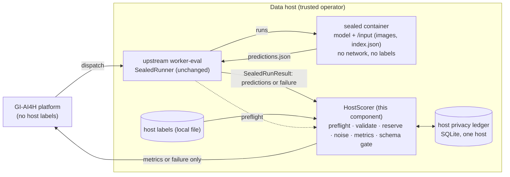

# Architecture

**Status: DRAFT — NOT YET APPROVED OR INTEGRATED.** Route version `0.2.1` (draft; not registered or reviewed).

## 1. Placement: on the data host

Per the organizer feedback (top of `THREAT_MODEL.md`): for clinical host tasks the platform never holds the labels. The data host runs the sealed execution, scores against its own labels and returns metrics, using the `metrics` branch of `SealedRunResult` that the platform's API already accepts and stores as-is (`apps/api/src/modules/evaluation/submission-result.service.ts`). This component is that host-side scorer.



The **reference task** is different: the platform holds its public labels and scores predictions in plaintext (`submission-result.service.ts` `predictions` branch and the Mode 1 upload). This component is not in that path; it is run on the reference task only to measure the fidelity gap.

## 2. Host release pipeline

1. **Preflight** (`host-preflight`, before `SealedRunner.run`): the dispatch must name this host's task, carry exactly this route version (required) and a canonical lower-case UUID; a submission that is in progress, failed or crashed is refused; a new submission needs a scope that can pay for it (a released submission may proceed: its replay is free). Otherwise a failure body is returned and the model is not run. Preflight is advisory, not a reservation.
2. **Sealed run** (upstream worker, unchanged): pull by digest, run under the §2.4 envelope, read and validate `predictions.json`.
3. **Finish** (`host-score`): a worker `failure` passes through (closed taxonomy only, no charge); a worker body with `metrics` or a malformed body is refused; `predictions` go to the scorer.
4. **Validate** predictions without labels; refusal costs nothing.
5. **Reserve** (one `BEGIN IMMEDIATE` transaction): mode check; resolve task → dataset → version → scope; replay check (same mode, submission, task, version, scope, predictions, ε → stored release; any difference → refuse); exact cap check; insert `RESERVED`.
6. **Compute** (`scorer.compute_release`, memory only): exact table, OpenDP discrete-Laplace noise at the calibrated scale, projection of each active column onto its known total, metrics, clamp, round.
7. **Record** `RELEASED` with the released metrics. If this fails, nothing is returned and the row stays charged.
8. **Schema gate**: the outgoing body must be exactly `{routeVersion, durationMs, metrics | failure}`; anything else becomes `INTERNAL_ERROR`.
9. The host's worker POSTs the body to the platform (upstream outbox).

Steps 1 and 3 are wired into the host's worker by the host **[INTEGRATION, G1]**. `integration/sealed_run/run_sealed_host.py` shows the wiring with the unmodified upstream runner.

## 3. Accounting identity (per host)

```
privacy scope (cap, opaque, host-assigned)  ← the budget owner, in the host's ledger
  └─ dataset (immutable binding)
       ├─ version v1, v2, … (immutable label set + immutable group factor g)
       └─ task(s) (immutable binding)
```

Label content never selects the budget. Identical or overlapping item sets cannot be registered in different scopes. Disjointness is checked by item identifier only.

## 4. Integration interface (proposal) [DECISION G1]

What a host adds around the upstream worker, in Python (as in `integration/sealed_run/run_sealed_host.py`):

```python
host = HostScorer(HostConfig.from_file("host.json"))       # once per worker process
refusal = host.preflight(message_dict)                     # before runner.run(message)
if refusal is not None:
    post(refusal)                                          # model not run
else:
    worker_body = runner.run(message).to_payload()         # upstream, unchanged
    post(host.finish(message_dict, worker_body))           # metrics or failure, never predictions
```

or, across process boundaries, the CLI (`host-preflight`, `host-score`) with the dispatch and the worker result as JSON files. Nothing on the platform side needs to change for host tasks: the API already accepts `metrics` results. Two points need agreement: where the hook lives (a `worker-eval` extension point, or a host-owned wrapper), and the route-version string the platform dispatches (G16).

Not implemented here: changes to the upstream worker or API; the outbox POST itself (the upstream worker does it); authentication between host and platform (upstream).

## 5. Modules (`src/privatemetrics/`)

| Module | Responsibility |
|---|---|
| `host.py` | Host configuration, registration, `HostScorer` (dispatch checks, preflight, finish), exact result-schema gate |
| `config.py` | Task and privacy configuration, validated (K, T, ε) |
| `validation.py` | Label-free prediction validation; upstream failure codes |
| `labels.py` | Label-set validation; content and item fingerprints for the registry; group-factor check against a patient map |
| `confusion.py` | Exact confusion table and prediction-only statistics |
| `mechanism.py` | OpenDP discrete Laplace; privacy-map check; seeded simulation sampler (refused outside simulation mode) |
| `postprocess.py` | Simplex projection; metric derivation with the upstream formulas; clamping, rounding, undefined-value policy |
| `budget.py` | Exact ε arithmetic on a 1e-6 grid; noise-scale calibration against OpenDP's privacy map |
| `ledger.py` | Registry (scope → dataset → version with group factor, task) and persistent transactional ledger (SQLite, `BEGIN IMMEDIATE`, one host, immutable mode) |
| `scorer.py` | Release pipeline steps 4–7; `compute_release` shared with the experiments |
| `adapter.py` | Builds the upstream `SealedRunResult` body; refuses non-production outcomes |
| `errors.py` | Failure codes, closed upstream taxonomy |
| `cli.py`, `__main__.py` | `python -m privatemetrics` |

## 6. Approaches compared

| Approach | Privacy argument | Utility at n = 30 | Why chosen or rejected |
|---|---|---|---|
| **Noisy confusion table, column-conditioned, discrete Laplace (chosen)** | Sensitivity 2 for any task size; one release yields all metrics; post-processing is free | Usable at ε ≈ 8 on 30 items (measured on the reference task), or at ε = 1 from a few hundred to 1,000 items (simulation) | Simplest correct argument; metrics stay mutually consistent |
| Projection vs. clipping as post-processing | Both free | On the reference `strong` fixture, clipping alone gave lower accuracy RMSE but higher QWK RMSE than projection (`REFERENCE_TASK_FIDELITY_REPORT.md` §5); earlier synthetic runs favoured projection for accuracy | Projection kept so all metrics come from one valid table; open item G18 |
| Noise each metric separately | Sensitivity per metric; sensitivity and specificity have data-dependent denominators; QWK's sensitivity is large; five releases compose | Worse | Rejected |
| Low-dimensional sufficient statistics | L1 sensitivity 39 per label change | Worse for accuracy and sensitivity; similar for QWK at ε = 1 (simulation) | Rejected; documented alternative |
| Discrete Gaussian with zCDP | (ε, δ) after conversion; better over many releases | Similar per release | Deferred: worth it if many releases per scope are allowed **[DECISION]** |
| Randomized response on labels | Local DP | Much worse | Rejected |
| Smooth sensitivity / propose-test-release | (ε, δ); complex to verify | Potentially better | Rejected for reviewability |
| Rounding or coarsening metrics only | Not DP | — | Rejected |
| Platform-side scoring service or API port (earlier options P1/P2) | Same guarantee | Same | Not applicable to host tasks: the platform does not hold host labels |

## 7. Deliberate non-goals

No container changes, no model training, no federated learning or encrypted computation, no change to the predictions contract, no new participant-facing fields, no changes to the upstream platform.
