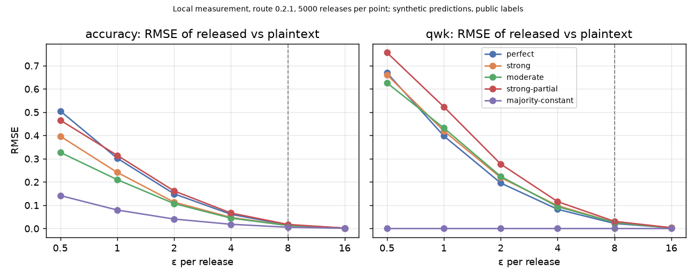
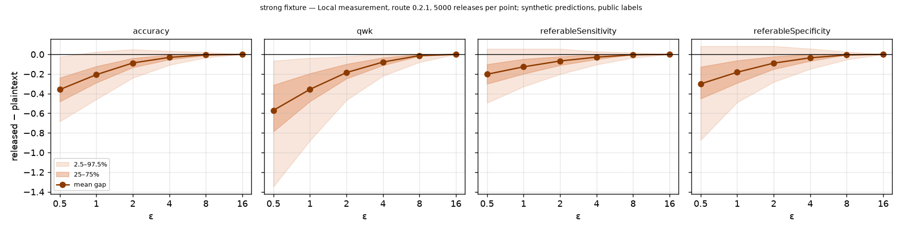
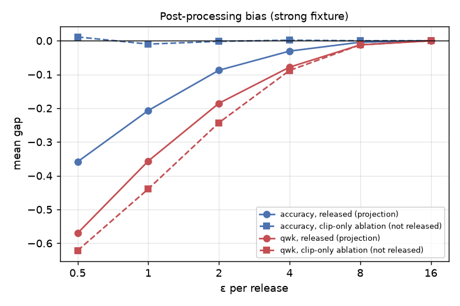

# Reference-task fidelity report

**Status: DRAFT — NOT YET APPROVED OR INTEGRATED.** Route version `0.2.1`.

Generated by `experiments/reference_fidelity.py`. Do not edit by hand; rerun to regenerate. Every number below comes from that run. This is a **local measurement of the noise mechanism on the public reference task**, run by the contributor. It is not a run on the GI-AI4H platform and not an official challenge evaluation.

## 1. Configuration

| Item | Value |
|---|---|
| Task | `idrid-dr-grading` (GRADING), 30 items, K = 5, referable threshold T = 2 |
| Labels | Public upstream fixture, `fixtures/reference/labels.csv` (SHA-256 `83e8a543…f779b3`); provenance in `fixtures/reference/README.md` |
| Predictions | **Synthetic** fixtures in `fixtures/reference/predictions/` (seeded perturbations of the labels; no official baseline predictions are published upstream) |
| Plaintext baseline | scoring.ts via Node (`tests/upstream/scoring.ts`, verbatim upstream copy) |
| Zero-noise parity with upstream | True (exact equality on every fixture) |
| DP sampler | OpenDP make_laplace (production, CSPRNG); OpenDP 0.16.0; Python 3.13.16 |
| Trials | 5000 independent releases per (ε, fixture) |
| Privacy unit | One item's label, replace-one; pure ε-DP (δ = 0) |
| Randomisation protocol | Each trial is one complete release: exact confusion table → fresh discrete-Laplace noise on every cell of each active column → projection onto the known column total → metrics → clamp → round to 4 decimals (`scorer.compute_release`, the function every release uses) |

## 2. Plaintext baseline (upstream `scoring.ts`)

| Fixture | qwk | accuracy | referableSensitivity | referableSpecificity | coverage |
|---|---|---|---|---|---|
| perfect | 1.0000 | 1.0000 | 1.0000 | 1.0000 | 1.0000 |
| strong | 0.9531 | 0.8000 | 0.9444 | 0.9167 | 1.0000 |
| moderate | 0.8042 | 0.6667 | 0.9444 | 0.6667 | 1.0000 |
| strong-partial | 0.9583 | 0.8333 | 0.9286 | 1.0000 | 0.8000 |
| majority-constant | 0.0000 | 0.2333 | 0.0000 | 1.0000 | 1.0000 |

Fixtures: `perfect` = the labels; `strong` = 80% exact, 20% off by one grade; `moderate` = 55% exact, 35% off by one, 10% off by two; `strong-partial` = `strong` with 6 of 30 items omitted (coverage 0.8); `majority-constant` = every item predicted grade 0.

## 3. Fidelity gap at the declared ε = 8

Gap = released − plaintext. CI = 95% normal-approximation interval of the mean gap. Quantiles are of the per-release gap.

### perfect

| Metric | Baseline | Mean released | Mean gap [95% CI] | SD | MAE | RMSE | 2.5% / 50% / 97.5% | within ±0.05 | within ±0.10 |
|---|---|---|---|---|---|---|---|---|---|
| qwk | 1.0000 | 0.9901 | -0.010 [-0.010, -0.009] | 0.019 | 0.010 | 0.022 | -0.06 / +0.00 / +0.00 | 94% | 100% |
| accuracy | 1.0000 | 0.9915 | -0.008 [-0.009, -0.008] | 0.013 | 0.008 | 0.015 | -0.04 / +0.00 / +0.00 | 99% | 100% |
| referableSensitivity | 1.0000 | 0.9959 | -0.004 [-0.004, -0.004] | 0.011 | 0.004 | 0.012 | -0.03 / +0.00 / +0.00 | 99% | 100% |
| referableSpecificity | 1.0000 | 0.9940 | -0.006 [-0.006, -0.006] | 0.015 | 0.006 | 0.016 | -0.04 / +0.00 / +0.00 | 99% | 100% |
| coverage | 1.0000 | 1.0000 | +0.000 [+0.000, +0.000] | 0.000 | 0.000 | 0.000 | +0.00 / +0.00 / +0.00 | 100% | 100% |

### strong

| Metric | Baseline | Mean released | Mean gap [95% CI] | SD | MAE | RMSE | 2.5% / 50% / 97.5% | within ±0.05 | within ±0.10 |
|---|---|---|---|---|---|---|---|---|---|
| qwk | 0.9531 | 0.9406 | -0.012 [-0.013, -0.012] | 0.023 | 0.013 | 0.026 | -0.08 / +0.00 / +0.00 | 93% | 99% |
| accuracy | 0.8000 | 0.7955 | -0.005 [-0.005, -0.004] | 0.012 | 0.008 | 0.013 | -0.03 / +0.00 / +0.02 | 99% | 100% |
| referableSensitivity | 0.9444 | 0.9398 | -0.005 [-0.005, -0.004] | 0.014 | 0.006 | 0.014 | -0.04 / +0.00 / +0.02 | 99% | 100% |
| referableSpecificity | 0.9167 | 0.9110 | -0.006 [-0.006, -0.005] | 0.019 | 0.010 | 0.020 | -0.05 / +0.00 / +0.03 | 97% | 100% |
| coverage | 1.0000 | 1.0000 | +0.000 [+0.000, +0.000] | 0.000 | 0.000 | 0.000 | +0.00 / +0.00 / +0.00 | 100% | 100% |

### moderate

| Metric | Baseline | Mean released | Mean gap [95% CI] | SD | MAE | RMSE | 2.5% / 50% / 97.5% | within ±0.05 | within ±0.10 |
|---|---|---|---|---|---|---|---|---|---|
| qwk | 0.8042 | 0.7947 | -0.009 [-0.010, -0.009] | 0.024 | 0.013 | 0.026 | -0.08 / +0.00 / +0.02 | 92% | 99% |
| accuracy | 0.6667 | 0.6627 | -0.004 [-0.004, -0.004] | 0.012 | 0.007 | 0.013 | -0.03 / +0.00 / +0.02 | 100% | 100% |
| referableSensitivity | 0.9444 | 0.9413 | -0.003 [-0.003, -0.003] | 0.012 | 0.005 | 0.012 | -0.03 / +0.00 / +0.02 | 99% | 100% |
| referableSpecificity | 0.6667 | 0.6645 | -0.002 [-0.003, -0.002] | 0.018 | 0.010 | 0.018 | -0.04 / +0.00 / +0.04 | 98% | 100% |
| coverage | 1.0000 | 1.0000 | +0.000 [+0.000, +0.000] | 0.000 | 0.000 | 0.000 | +0.00 / +0.00 / +0.00 | 100% | 100% |

### strong-partial

| Metric | Baseline | Mean released | Mean gap [95% CI] | SD | MAE | RMSE | 2.5% / 50% / 97.5% | within ±0.05 | within ±0.10 |
|---|---|---|---|---|---|---|---|---|---|
| qwk | 0.9583 | 0.9438 | -0.014 [-0.015, -0.014] | 0.027 | 0.015 | 0.031 | -0.09 / +0.00 / +0.00 | 89% | 98% |
| accuracy | 0.8333 | 0.8251 | -0.008 [-0.009, -0.008] | 0.016 | 0.010 | 0.018 | -0.05 / +0.00 / +0.01 | 98% | 100% |
| referableSensitivity | 0.9286 | 0.9240 | -0.005 [-0.005, -0.004] | 0.015 | 0.007 | 0.016 | -0.04 / +0.00 / +0.02 | 99% | 100% |
| referableSpecificity | 1.0000 | 0.9918 | -0.008 [-0.009, -0.008] | 0.020 | 0.008 | 0.021 | -0.06 / +0.00 / +0.00 | 95% | 100% |
| coverage | 0.8000 | 0.8000 | +0.000 [+0.000, +0.000] | 0.000 | 0.000 | 0.000 | +0.00 / +0.00 / +0.00 | 100% | 100% |

### majority-constant

| Metric | Baseline | Mean released | Mean gap [95% CI] | SD | MAE | RMSE | 2.5% / 50% / 97.5% | within ±0.05 | within ±0.10 |
|---|---|---|---|---|---|---|---|---|---|
| qwk | 0.0000 | 0.0000 | +0.000 [+0.000, +0.000] | 0.000 | 0.000 | 0.000 | +0.00 / +0.00 / +0.00 | 100% | 100% |
| accuracy | 0.2333 | 0.2334 | +0.000 [-0.000, +0.000] | 0.006 | 0.002 | 0.006 | -0.01 / +0.00 / +0.01 | 100% | 100% |
| referableSensitivity | 0.0000 | 0.0000 | +0.000 [+0.000, +0.000] | 0.000 | 0.000 | 0.000 | +0.00 / +0.00 / +0.00 | 100% | 100% |
| referableSpecificity | 1.0000 | 1.0000 | +0.000 [+0.000, +0.000] | 0.000 | 0.000 | 0.000 | +0.00 / +0.00 / +0.00 | 100% | 100% |
| coverage | 1.0000 | 1.0000 | +0.000 [+0.000, +0.000] | 0.000 | 0.000 | 0.000 | +0.00 / +0.00 / +0.00 | 100% | 100% |

## 4. Gap across ε (strong fixture)

| ε | scale | certified ε | metric | mean gap | SD | RMSE | within ±0.05 | within ±0.10 |
|---|---|---|---|---|---|---|---|---|
| 0.5 | 4 | 0.5 | accuracy | -0.359 | 0.170 | 0.397 | 3% | 6% |
| 0.5 | 4 | 0.5 | qwk | -0.570 | 0.335 | 0.661 | 2% | 4% |
| 0.5 | 4 | 0.5 | referableSensitivity | -0.203 | 0.148 | 0.251 | 9% | 25% |
| 0.5 | 4 | 0.5 | referableSpecificity | -0.301 | 0.240 | 0.385 | 8% | 22% |
| 1 | 2 | 1 | accuracy | -0.207 | 0.125 | 0.241 | 9% | 19% |
| 1 | 2 | 1 | qwk | -0.356 | 0.221 | 0.420 | 4% | 9% |
| 1 | 2 | 1 | referableSensitivity | -0.127 | 0.103 | 0.164 | 20% | 41% |
| 1 | 2 | 1 | referableSpecificity | -0.182 | 0.157 | 0.240 | 15% | 32% |
| 2 | 1 | 2 | accuracy | -0.088 | 0.072 | 0.114 | 28% | 57% |
| 2 | 1 | 2 | qwk | -0.185 | 0.117 | 0.219 | 9% | 25% |
| 2 | 1 | 2 | referableSensitivity | -0.068 | 0.064 | 0.093 | 37% | 69% |
| 2 | 1 | 2 | referableSpecificity | -0.089 | 0.093 | 0.129 | 29% | 56% |
| 4 | 0.5 | 4 | accuracy | -0.031 | 0.037 | 0.048 | 70% | 96% |
| 4 | 0.5 | 4 | qwk | -0.078 | 0.059 | 0.098 | 37% | 70% |
| 4 | 0.5 | 4 | referableSensitivity | -0.028 | 0.035 | 0.045 | 74% | 97% |
| 4 | 0.5 | 4 | referableSpecificity | -0.035 | 0.052 | 0.062 | 61% | 89% |
| 8 | 0.25 | 8 | accuracy | -0.005 | 0.012 | 0.013 | 99% | 100% |
| 8 | 0.25 | 8 | qwk | -0.012 | 0.023 | 0.026 | 93% | 99% |
| 8 | 0.25 | 8 | referableSensitivity | -0.005 | 0.014 | 0.014 | 99% | 100% |
| 8 | 0.25 | 8 | referableSpecificity | -0.006 | 0.019 | 0.020 | 97% | 100% |
| 16 | 0.125 | 16 | accuracy | -0.000 | 0.002 | 0.002 | 100% | 100% |
| 16 | 0.125 | 16 | qwk | -0.000 | 0.003 | 0.003 | 100% | 100% |
| 16 | 0.125 | 16 | referableSensitivity | -0.000 | 0.002 | 0.002 | 100% | 100% |
| 16 | 0.125 | 16 | referableSpecificity | -0.000 | 0.003 | 0.003 | 100% | 100% |

Share of releases whose **five metrics all equal the plaintext values** (strong fixture). At large ε the noise is so small that many releases are the exact plaintext result; this is what a large ε means, and it is why the reference ε is a utility choice, not a protection claim:

| ε | 0.5 | 1 | 2 | 4 | 8 | 16 |
|---|---|---|---|---|---|---|
| all five metrics exact | 0% | 0% | 0% | 1% | 53% | 99% |

Accuracy RMSE by ε and fixture:

| ε | perfect | strong | moderate | strong-partial | majority-constant |
|---|---|---|---|---|---|
| 0.5 | 0.505 | 0.397 | 0.327 | 0.466 | 0.142 |
| 1 | 0.302 | 0.241 | 0.210 | 0.315 | 0.080 |
| 2 | 0.149 | 0.114 | 0.107 | 0.162 | 0.041 |
| 4 | 0.061 | 0.048 | 0.045 | 0.067 | 0.018 |
| 8 | 0.015 | 0.013 | 0.013 | 0.018 | 0.006 |
| 16 | 0.002 | 0.002 | 0.002 | 0.002 | 0.001 |

QWK RMSE by ε and fixture:

| ε | perfect | strong | moderate | strong-partial | majority-constant |
|---|---|---|---|---|---|
| 0.5 | 0.670 | 0.661 | 0.626 | 0.756 | 0.000 |
| 1 | 0.398 | 0.420 | 0.432 | 0.523 | 0.000 |
| 2 | 0.196 | 0.219 | 0.224 | 0.277 | 0.000 |
| 4 | 0.083 | 0.098 | 0.094 | 0.116 | 0.000 |
| 8 | 0.022 | 0.026 | 0.026 | 0.031 | 0.000 |
| 16 | 0.003 | 0.003 | 0.003 | 0.004 | 0.000 |

## 5. Bias from post-processing

Mean gaps are negative: released values understate the plaintext metrics, more so at small ε. The noise itself is symmetric and unbiased, so the bias comes from what is done with it: each noisy column is projected onto its known total (cells cannot be negative and must sum to the column count), released values are clamped to their valid range, and QWK, sensitivity and specificity are nonlinear in the cells. For a column concentrated on its diagonal, any noise mass the projection keeps lands off the diagonal, so good models are reported as somewhat worse. The ablation below replaces the projection with clipping at zero (analysis only, never released) on the `strong` fixture, to show which part of the bias the projection causes:

| ε | metric | mean gap, released (projection) | mean gap, clip-only | RMSE, released | RMSE, clip-only |
|---|---|---|---|---|---|
| 0.5 | accuracy | -0.359 | +0.011 | 0.397 | 0.206 |
| 0.5 | qwk | -0.570 | -0.622 | 0.661 | 0.674 |
| 1 | accuracy | -0.207 | -0.010 | 0.241 | 0.158 |
| 1 | qwk | -0.356 | -0.439 | 0.420 | 0.485 |
| 2 | accuracy | -0.088 | -0.002 | 0.114 | 0.096 |
| 2 | qwk | -0.185 | -0.243 | 0.219 | 0.278 |
| 4 | accuracy | -0.031 | +0.001 | 0.048 | 0.046 |
| 4 | qwk | -0.078 | -0.088 | 0.098 | 0.119 |
| 8 | accuracy | -0.005 | -0.000 | 0.013 | 0.015 |
| 8 | qwk | -0.012 | -0.012 | 0.026 | 0.033 |
| 16 | accuracy | -0.000 | -0.000 | 0.002 | 0.002 |
| 16 | qwk | -0.000 | -0.000 | 0.003 | 0.004 |

Reading: where the clip-only accuracy gap is near zero but the released one is not, the accuracy bias is caused by the projection. QWK is biased under both variants, so most of its bias comes from noise entering a nonlinear statistic, not from the projection. The projection is kept because it guarantees that all five released metrics come from one valid table (non-negative cells that sum to the known column totals). It is **not** uniformly more accurate: compare the RMSE columns. Changing the post-processing step would not change the privacy guarantee (post-processing is free) and is a possible improvement; it is not made in this version. The bias is reported rather than corrected, since a correction would itself depend on the unknown true table.

Coverage has no gap and no noise: it depends only on predictions (`THREAT_MODEL.md` §7.5).

## 6. End-to-end host path

120 releases of the `strong` fixture through `HostScorer.finish` (dispatch check, production ledger with `BEGIN IMMEDIATE` reservation and persistence, schema check) at ε = 8, each under a new submission ID.

| Metric | Mean gap | SD | Mechanism-only mean gap (same ε, §3) | Mechanism-only SD |
|---|---|---|---|---|
| qwk | -0.015 | 0.022 | -0.012 | 0.023 |
| accuracy | -0.007 | 0.012 | -0.005 | 0.012 |
| referableSensitivity | -0.006 | 0.015 | -0.005 | 0.014 |
| referableSpecificity | -0.006 | 0.017 | -0.006 | 0.019 |
| coverage | +0.000 | 0.000 | +0.000 | 0.000 |

| Measurement | Value |
|---|---|
| Time per host release (median / p95 / max) | 8.57 / 12.84 / 31.87 ms |
| Peak traced Python allocation during the 120 releases | 0.09 MiB |
| Maximum resident set size of the whole experiment process | 62 MiB |
| ε charged to the scope by the end-to-end run | 960 (120 × 8) |
| Mechanism-only releases, total wall time | 82.3 s for 150000 releases |

Timing varies by machine; these are observations on the contributor's environment, not caps.

## 7. ε selection

Rule: smallest ε with >=80% of strong-fixture releases within ±0.10 for accuracy and QWK. Smallest ε meeting it in this run: **8**. Declared reference-demonstration ε: **8**.

This is a utility rule for a 30-item demonstration, not a privacy recommendation. At this ε one release is a weak guarantee for any individual label. The reference labels are public, so nothing secret is at stake on the reference task; the ε is chosen so that the demonstration shows usable numbers.

Three different numbers must be kept apart:

| Quantity | Reference demonstration | Host task |
|---|---|---|
| ε per release | 8 (this report) | **[DECISION G4]**, set by the host. At ε = 1, accuracy SD is about 0.02 at 300 items and 0.006 at 1,000 (`EXPERIMENT_REPORT.md` §2) |
| Global cap per privacy scope | 80 in the demonstration (`scripts/host_demo.py`): 10 releases | **[DECISION G4]**, set by the host at registration |
| Patient-level ε | g × label-level ε; g = 2 declared for the reference slice (unverified; patients are not identified upstream) | g declared and, where a patient map exists, checked by the host |

Cost of repeated releases (basic composition, pure DP): k releases at ε each cost k·ε against one scope, whoever submits them. Upstream quotas (3 per task per week, 10 per task, per participant) do not bound the total across participants; the scope cap does.

| Releases k | Label-level ε at ε = 8 | Patient-level ε with g = 2 |
|---|---|---|
| 1 | 8 | 16 |
| 3 | 24 | 48 |
| 10 | 80 | 160 |
| 30 | 240 | 480 |

## 8. Figures

Generated from `experiments/results/reference_fidelity.json` by `python experiments/plot_fidelity.py` (needs matplotlib, `pip install -e ".[plots]"`).



*RMSE of released accuracy and QWK against ε, per fixture (log-scaled ε).*



*Strong fixture: mean gap (line) with the 2.5–97.5% and 25–75% ranges of the per-release gap (bands), per metric and ε.*



*Strong fixture: mean gap of released values (projection) and of the clip-only ablation.*

## 9. Reproduction

```sh
python experiments/reference_fidelity.py                  # this report (fresh production noise)
python experiments/reference_fidelity.py --simulation 7   # bit-reproducible run with the seeded sampler
python fixtures/reference/make_prediction_fixtures.py --check
```

Production-noise reruns differ release by release; summary statistics agree within their CIs (`tests/test_host_demo_and_fidelity.py` checks this on a reduced run). Raw per-cell results: `experiments/results/reference_fidelity.json` and `reference_fidelity_summary.csv`.

### Agreement with the previous committed run

This run was compared cell by cell with the earlier committed run (route `0.2.1-draft`, 5000 trials per cell, kept as `experiments/results/reference_fidelity_previous_v0.2.1-draft.json`; an earlier run is kept as `reference_fidelity_previous_v0.2.0.json`). The mechanism code is the same in all three. A cell agrees if the two mean released values differ by at most 4 combined standard errors.

| Cells compared | Within 4 SE | Largest z (absolute) | Largest absolute difference in mean released value |
|---|---|---|---|
| 150 | 150 | 2.54 | 0.0105 |

## 10. Limitations

* Predictions are synthetic fixtures, not real models. The gap depends on the model's confusion structure; real submissions will differ.
* 30 items is very small: the noise needed for one label's protection is large relative to each cell. This is the main utility limitation of label-DP on this task (`THREAT_MODEL.md` §8.1).
* Measured locally, not on the platform. A platform run needs integration (`GAP_ANALYSIS.md` G1).
* The reference labels are public; the measurement shows behaviour and utility, not protection.
* Released values are biased (§5); the bias is reported, not corrected.

